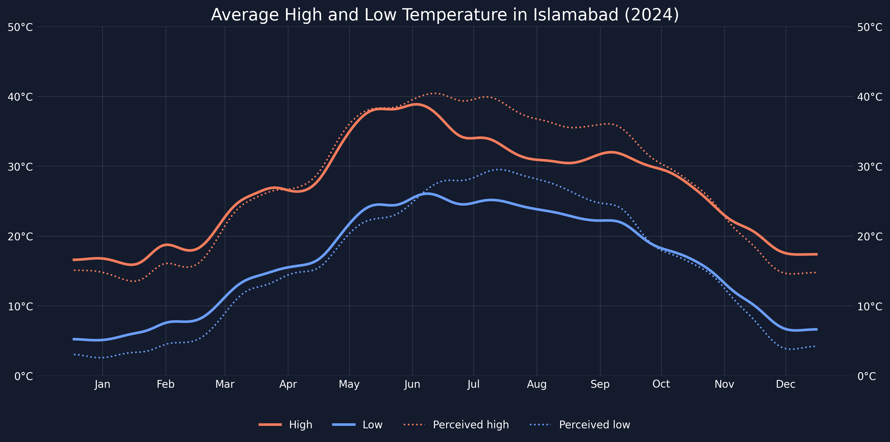

# 🌡️ Islamabad Weather 2024 — High, Low & "Feels Like"

A small data-viz project that pulls a full year of daily weather for Islamabad, Pakistan
(33.68°N, 73.04°E) from the [Open-Meteo Archive API](https://open-meteo.com/) and plots
actual vs. perceived temperatures on a dark-themed chart.



## What it does

1. Fetches 2024 daily `temperature_2m_max/min` and `apparent_temperature_max/min`
   for Islamabad (timezone `Asia/Karachi`).
2. Smooths each series with a **7-day Gaussian filter** (`scipy.ndimage.gaussian_filter1d`,
   `sigma=7`) to remove day-to-day noise and reveal the seasonal curve.
3. Plots four series on a dark background:
   - 🔶 **High** — solid orange
   - 🔷 **Low** — solid blue
   - 🔶 **Perceived high** — dotted orange
   - 🔷 **Perceived low** — dotted blue
4. Exports a 300 DPI PNG and a tidy Excel workbook.

## Key takeaways

<!-- Fill these in from your own data — don't guess! -->
- Hottest stretch: **[MONTH]** peaked at **[X.X °C]** (perceived **[X.X °C]**)
- Coldest night: **[MONTH]**, **[X.X °C]**
- Widest gap between actual and "feels like": **[DATE]**, **[±X.X °C]**
- The perceived-temp curve tracks the actual curve closely in winter but diverges
  during the pre-monsoon heat (May–June) — humidity does the heavy lifting.

## The data

| Field | Description |
|---|---|
| `temperature_2m_max` / `_min` | Daily max/min air temp at 2 m (°C) |
| `apparent_temperature_max` / `_min` | "Feels like" — combines temp, humidity, wind, solar radiation |
| `time` | Date (daily resolution) |

Source: Open-Meteo Archive (ERA5 reanalysis). No API key required.

## Run it

```bash
pip install -r requirements.txt
jupyter notebook Islamabad_Weather.ipynb
